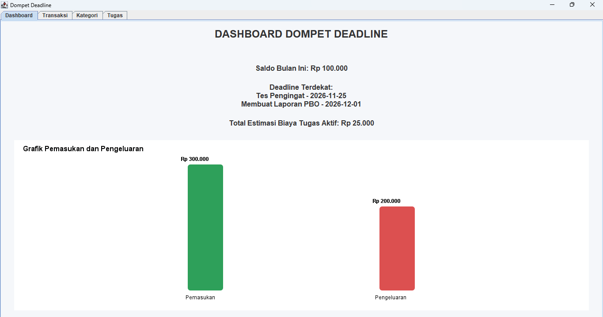
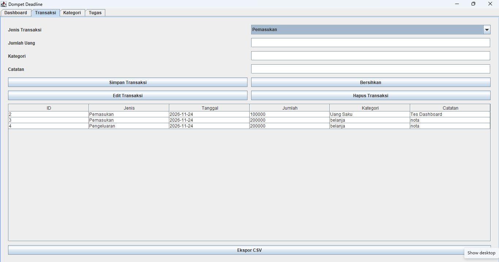
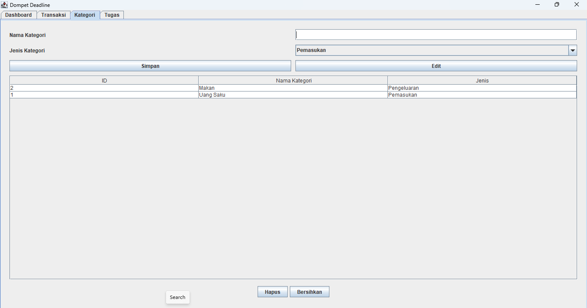
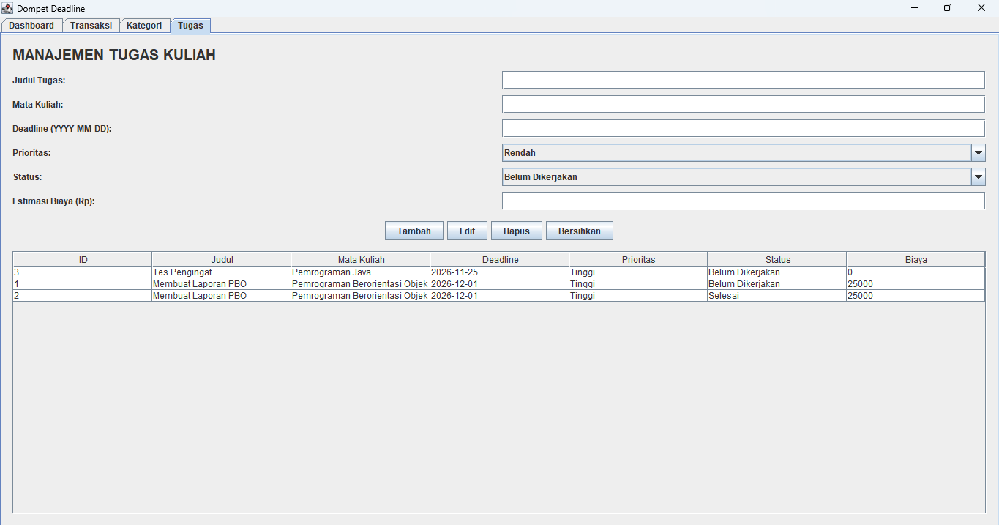

# Dompet Deadline

**Dompet Deadline** adalah aplikasi desktop berbasis Java yang dibuat untuk membantu mahasiswa mengatur keuangan dan mengelola tugas kuliah agar lebih terorganisir.

## Fitur Aplikasi

### 1. Manajemen Transaksi
- Mencatat pemasukan dan pengeluaran.
- Menambahkan, mengedit, dan menghapus transaksi.
- Menyimpan tanggal, jumlah, kategori, dan catatan transaksi.
- Mengekspor data transaksi ke format CSV.

### 2. Manajemen Kategori
- Menambahkan kategori transaksi.
- Mengedit kategori.
- Menghapus kategori.

### 3. Manajemen Tugas
- Menambahkan, mengedit, dan menghapus tugas.
- Menyimpan mata kuliah, deadline, prioritas, dan status tugas.
- Mencatat perkiraan biaya setiap tugas.

### 4. Dashboard
- Menampilkan ringkasan saldo bulanan.
- Menampilkan tiga deadline terdekat.
- Menampilkan total biaya tugas yang belum selesai.
- Menampilkan grafik pemasukan dan pengeluaran bulanan.

### 5. Pengingat Deadline
- Memberikan pengingat tugas yang mendekati deadline.
- Memberikan pemberitahuan ketika deadline tiba.
- Memberikan pemberitahuan untuk tugas yang terlambat.
- Mencegah pengingat yang sama muncul berulang kali.

## Screenshot Aplikasi

### Dashboard


### Transaksi


### Kategori


### Tugas


## Teknologi yang Digunakan

- Java JDK 11 atau lebih baru
- Java Swing
- JDBC
- SQLite
- SQLite JDBC
- JUnit 5

## Struktur Folder

```text
DompetDeadline/
├── lib/
│   ├── sqlite-jdbc-3.54.1.0.jar
│   └── junit-platform-console-standalone-1.11.4.jar
├── src/
│   ├── Main.java
│   ├── model/
│   ├── repository/
│   ├── service/
│   └── view/
├── test/
│   └── TaskTest.java
├── screenshots/
│   ├── Dashboard.png
│   ├── Transaksi.png
│   ├── Kategori.png
│   └── Tugas.png
├── release-package/
├── MANIFEST.MF
├── .gitignore
├── LICENSE
└── README.md
```

## Cara Menjalankan Aplikasi

1. Pastikan Java JDK 11 atau lebih baru sudah terinstal.
2. Unduh file `DompetDeadline-v1.0.0.zip` dari halaman GitHub Releases.
3. Ekstrak file ZIP.
4. Pastikan file `DompetDeadline.jar` dan folder `lib` berada dalam satu folder.
5. Jalankan aplikasi dengan perintah:

```bash
java -jar DompetDeadline.jar
```

## Menjalankan Unit Test

Untuk menjalankan pengujian JUnit, gunakan perintah berikut di terminal PowerShell dari folder proyek:

```powershell
javac -cp "lib/*;out" -d out test/TaskTest.java
```

Kemudian jalankan:

```powershell
java -jar lib/junit-platform-console-standalone-1.11.4.jar execute --class-path "out;lib/sqlite-jdbc-3.54.1.0.jar" --select-class TaskTest
```

Pengujian mencakup:
- Pengujian data tugas.
- Pengujian perubahan status tugas.
- Pengujian biaya tugas.

## Database

Aplikasi menggunakan SQLite untuk menyimpan data secara lokal.

Database dibuat secara otomatis di folder pengguna dengan nama:

`DompetDeadline/dompet_deadline.db`

Database pribadi tidak disertakan dalam repository GitHub.

## GitHub Repository

Repository: https://github.com/zahraagmelia/DompetDeadline

Download aplikasi: https://github.com/zahraagmelia/DompetDeadline/releases

## Pengembang

Dibuat oleh **Zahra Agmelia**.